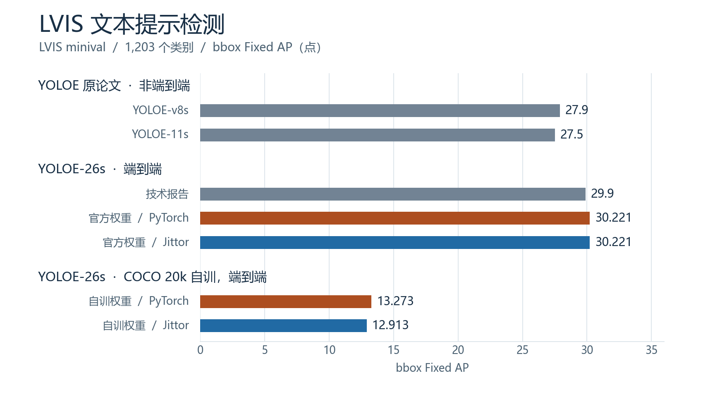
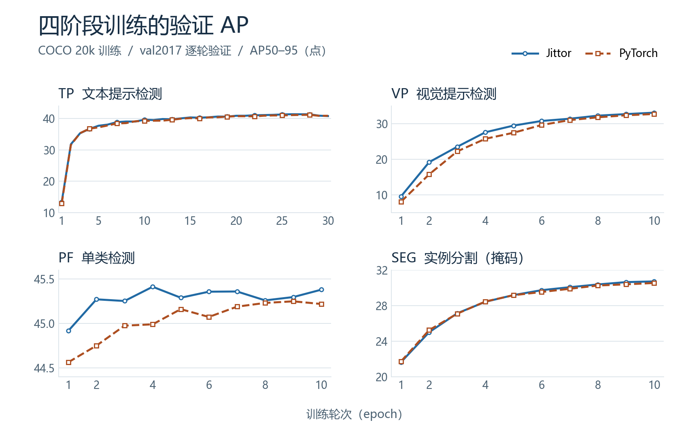

# YOLOE-26s in Jittor

YOLOE 开放词汇检测与实例分割的 Jittor 实现。基于 YOLOE-26s，在固定的 COCO 20,000 张训练图上完成文本提示（TP）、视觉提示（VP）、无提示检测（PF）和实例分割（SEG）四阶段训练。模型、文本编码器、梯度更新与推理使用 Jittor，数据处理和指标使用 NumPy/OpenCV。小规模的 YOLOE-11s 文本提示适配另有[使用说明](yoloe11/README.md)。

## 结果

### LVIS 零样本文本提示检测



原始 YOLOE 论文报告的是 v8s 和 11s 的非端到端结果。与本仓库型号和检测头对应的文献参照来自后续 YOLO26 技术报告：26s 在开放词汇训练配方下达到 **29.9 AP**。[YOLOE 原论文表 1](https://arxiv.org/html/2503.07465v1#S4.T1) · [YOLO26 技术报告表 12](https://arxiv.org/html/2606.03748v1#S4.T12)

在 LVIS minival 的 4,809 张图、1,203 个类别上，同一份官方权重经 PyTorch 和 Jittor 推理，bbox Fixed AP 分别为 **30.220828** 和 **30.220837**。在 COCO 20k 上分别训练 TP 后，PyTorch 为 **13.273**，Jittor 为 **12.913**。因此在本次实验中，Jittor 自训权重距同配置 PyTorch **0.360 AP**，距技术报告的大规模训练结果 **16.987 AP**。[同权重复测](verification/yoloe26-official-lvis.json) · [COCO 20k 自训对照](verification/lvis-coco20k-release.json)

### COCO 四阶段训练与最佳权重



折线来自正式训练日志。两边均用 20,000 张图训练、5,000 张图验证，每个点为该轮结束时的 AP50–95。各子图使用各自标出的纵轴范围，PF 放大了 45 AP 附近的变化。VP、PF、SEG 各自从本框架的 TP 最佳权重开始训练；Jittor 的 PF 将步长 32 的单类输出偏置预热起始学习率调至 0.01。[逐轮数据](verification/coco20k-epoch-ap.csv) · [绘图脚本](docs/figures/plot_results.py)

下表给出最佳权重重载后独立验证的 AP50–95。训练期间的逐轮验证按长宽比分批，独立验证使用单独的评测流程，两者的数值可略有不同。差值按原始精度计算，正值表示 Jittor 较高。[四阶段原始指标与哈希](verification/coco20k-release.json) · [PyTorch 基线代码](reference/pytorch/README.md)

| 任务 | PyTorch | Jittor | Jittor − PyTorch（AP 点） |
| --- | ---: | ---: | ---: |
| TP 文本提示检测 | 41.214 | 41.138 | −0.076 |
| VP 视觉提示检测 | 32.774 | 32.662 | −0.112 |
| PF 单类检测 | 45.248 | 45.046 | −0.202 |
| PF 80 类检索 | 41.195 | 41.117 | −0.078 |
| SEG 实例分割（掩码） | 29.410 | 30.650 | +1.240 |

## 快速开始：在一张图上尝试文本提示

从仓库根目录执行。Linux / WSL2 测试环境为 Python 3.10、Jittor 1.3.11.0 和可用的 C++ 编译器。CUDA 训练实测使用 A800 80 GB、CUDA Toolkit 11.8 和 cuDNN 8。已有 Jittor 环境可以直接从下载权重开始。

```bash
git clone https://github.com/Lipeilin0307/YOLOE-26s-Jittor.git
cd YOLOE-26s-Jittor
python3.10 -m venv .venv
source .venv/bin/activate
python -m pip install -r requirements.txt
python fetch_weights.py demo
mkdir -p data/example
curl -fL --retry 3 https://huggingface.co/datasets/huggingface/documentation-images/resolve/main/coco_sample.png -o data/example/cats.png
python predict.py --device cpu --init init --weights weights/tp-coco20k.npz \
  --text-model mobileclip2_b.ts --image data/example/cats.png --classes cat --conf 0.15
```

输出 JSON 包含类别、置信度和原图上的像素坐标 `[x1,y1,x2,y2]`。本机 CPU 在这张图上检出了两只猫，置信度为 0.943 和 0.916。也可换用自己的图像和提示词。Jittor 首次运行会编译算子。

## 下载权重

[下载 v1.0.0](https://github.com/Lipeilin0307/YOLOE-26s-Jittor/releases/tag/v1.0.0) 提供四份 Jittor 最佳权重、检测与分割的两个原生初始化文件和校验和。各阶段使用的架构文件及冻结的 COCO 类别嵌入在 `init/` 中。下载脚本从官方上游获取独立的 MobileCLIP2-B 文本编码器。所有下载逐文件核对 SHA-256。[文件清单](weights/manifest.json)

| 命令 | 用途 |
| --- | --- |
| `python fetch_weights.py demo` | 单图新类别推理，含文本编码器 |
| `python fetch_weights.py train` | 从实验初始参数训练四阶段 |
| `python fetch_weights.py VP` | 只下载复测该阶段所需的文件；也支持 TP、PF、SEG |
| `python fetch_weights.py all` | 下载全部文件；加 `--check` 仅核对已下载文件 |

## 复测或训练

准备原始 COCO 2017 的 `train2017/`、`val2017/` 和 `annotations/instances_{train,val}2017.json`。四份图像清单随仓库提供。小规模验证使用 200 张训练图和另外 200 张验证图，正式实验使用 20,000 张训练图和 5,000 张验证图。[COCO 下载页](https://cocodataset.org/#download) · [图像划分](splits/)

```bash
export NVIDIA_TF32_OVERRIDE=0 OPENBLAS_NUM_THREADS=2
COCO=/path/to/coco2017
python prepare.py --profile full --coco-root "$COCO" --out data/coco20k
python fetch_weights.py all
for stage in TP VP PF SEG; do
  python evaluate.py --stage "$stage" --data data/coco20k --device cuda
done
```

评测命令直接读取发布的检查点，输出指标范围为 0–1。PF 同时报告单类检测和 80 类检索，VP 仅从训练划分提取视觉提示。原始训练使用 640 输入、batch 8、FP32，TP 训练 30 轮，其余三个阶段各 10 轮。以下命令从相同初始化训练并重载各自的最佳权重。

```bash
python fetch_weights.py train
python train.py --init init --data data/coco20k --out runs/coco20k \
  --device cuda --imgsz 640 --batch 8 --workers 2 --pf-p5-bias-warmup-lr 0.01
python train.py --init init --data data/coco20k --out runs/coco20k \
  --device cuda --imgsz 640 --batch 8 --workers 2 --pf-p5-bias-warmup-lr 0.01 --verify-only
```

快速检查四阶段代码时，将数据准备改为 `--profile smoke --out data/smoke200`，训练时使用 `--data data/smoke200 --out runs/smoke200` 并省略 `--imgsz`。该配置使用 320 输入，每阶段训练一轮；可用 `--device cpu`。训练目录保存最佳和末轮权重、EMA、优化器断点和复验结果。数据准备需要新的输出目录，训练重启则复用对应的运行目录。

## PF 为什么回退

修订版 TP 使用原 PF 配方时，单类 AP 为 41.385。固定 48 张图逐批跟踪发现，新旧 TP 的 P5 正样本位置从第 325 批起持续分歧；第 364 批起，新 TP 原配方连续 25 批给参考位置左邻更高的中位分数。只将 P5 单类输出偏置的预热起始学习率从 0.1 降至 0.01，完整 10 轮后的 AP 回到 45.046。这个结果来自本次划分和种子。[逐批曲线](verification/pf-epoch1-diagnostics.png) · [单轮消融](verification/yoloe26-pf-epoch1.json) · [十轮复验](verification/yoloe26-pf-slow-bias-coco20k.json)

四份发布权重也在干净检出的代码中逐个重载，使用 CPU、320 输入和相同的 200 张验证图完成评测。[发布版 200 张验证记录](verification/release-smoke200.json)。LVIS 评测、同义提示实验和历史验证数据见[实验说明](docs/experiments.md)。

## 来源与许可

代码采用 [AGPL-3.0](LICENSE)，几何变换沿用 Ultralytics 8.4.216。CLIP 分词器和词表源自 OpenAI，保留 [MIT 许可](LICENSE-CLIP)。检测初始参数源自 Ultralytics 的 Objects365 预训练 YOLO26s，分割新增分支来自配对实验初始化；导出方式见 `export.py`。预训练模型、MobileCLIP2 和 COCO 图像与标注各自沿用上游使用条款。[Ultralytics 模型发布](https://github.com/ultralytics/assets/releases/tag/v8.4.0) · [Apple MobileCLIP](https://github.com/apple/ml-mobileclip) · [COCO 使用条款](https://cocodataset.org/#termsofuse)

原论文为 Ao Wang 等人的 *YOLOE: Real-Time Seeing Anything*（ICCV 2025）；26s 采用后续 YOLO26 技术报告的模型。本仓库为独立复现。[YOLOE 论文](https://openaccess.thecvf.com/content/ICCV2025/html/Wang_YOLOE_Real-Time_Seeing_Anything_ICCV_2025_paper.html) · [YOLOE 官方实现](https://github.com/THU-MIG/yoloe) · [Jittor](https://github.com/Jittor/jittor)
